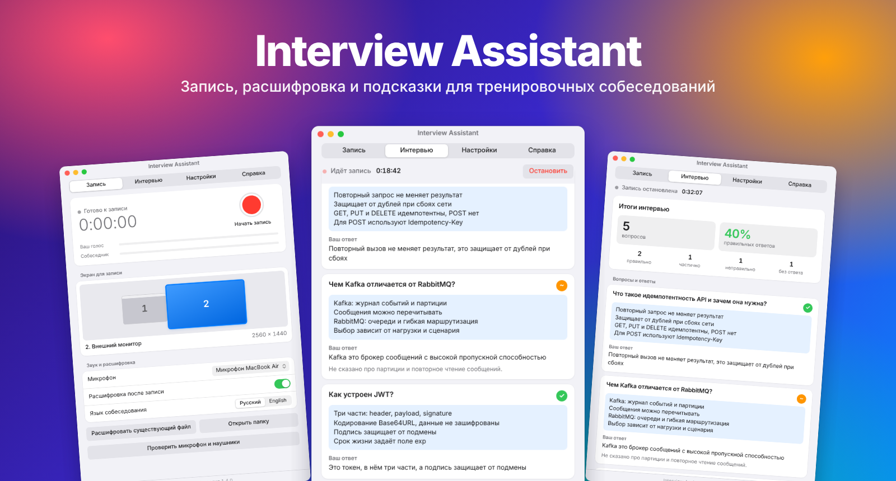
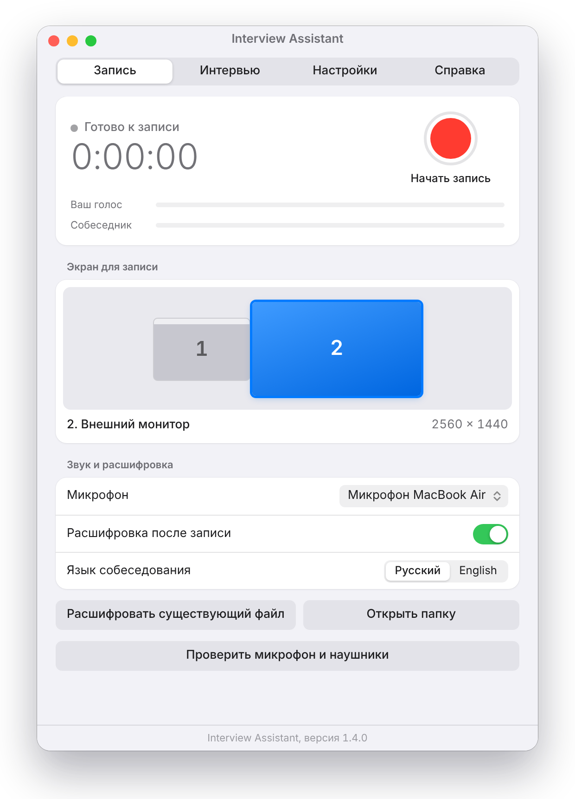
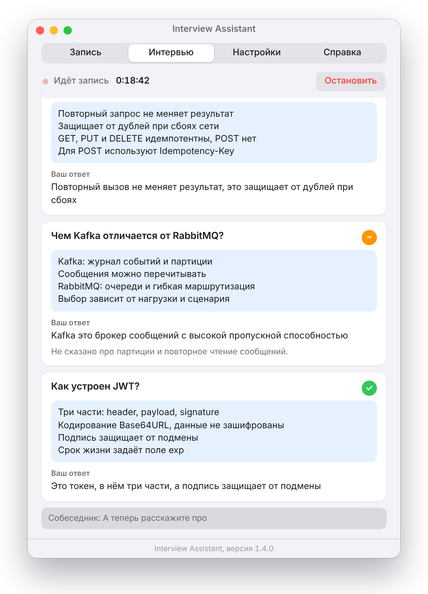
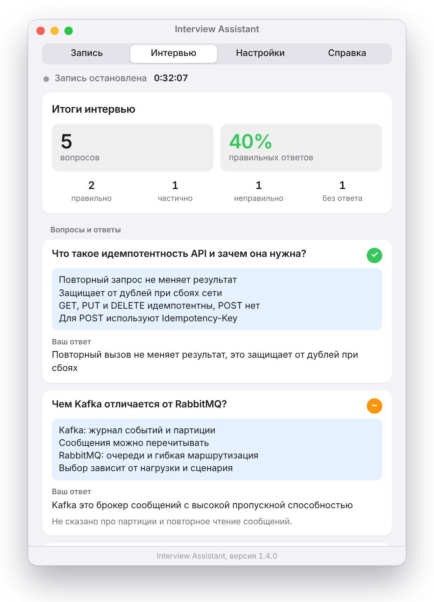
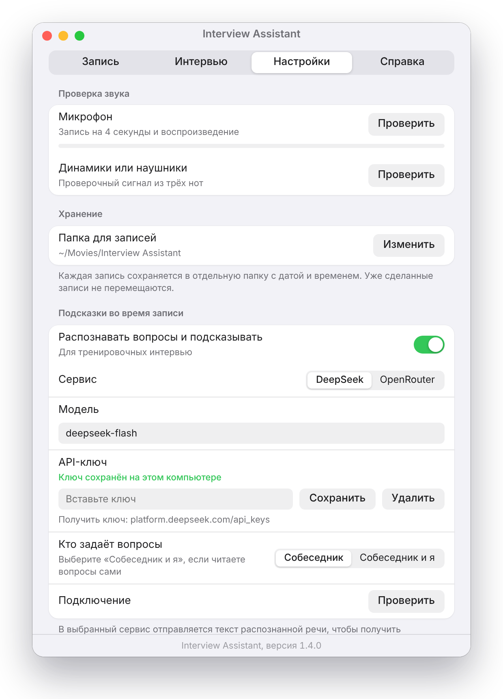
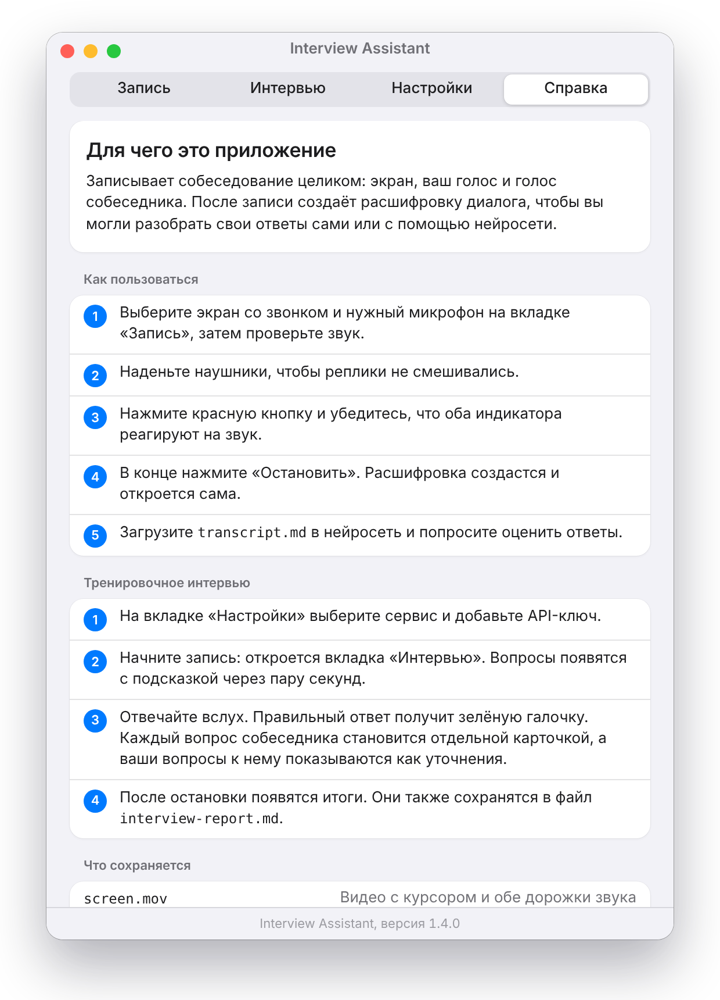
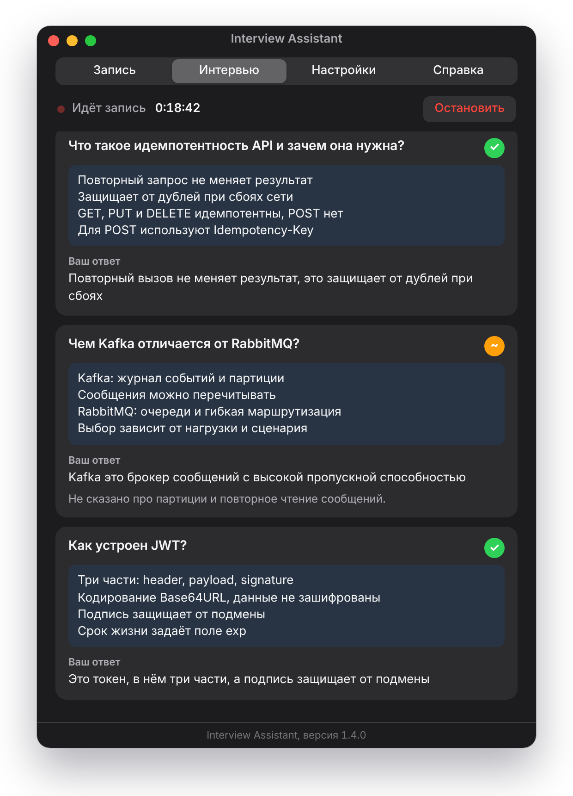
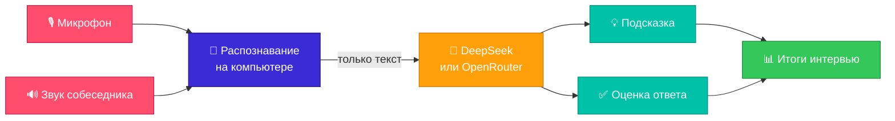

<p align="center">
  
</p>

<p align="center">
  
  
  
  
  
  
  
</p>

<h3 align="center">Записывайте собеседования, получайте расшифровку и тренируйтесь с подсказками ИИ</h3>

<p align="center">
  <a href="#-возможности">Возможности</a> •
  <a href="#-скриншоты">Скриншоты</a> •
  <a href="#-как-это-работает">Как это работает</a> •
  <a href="#-установка">Установка</a> •
  <a href="#-статус-проекта">Статус</a>
</p>

---

**Interview Assistant** помогает готовиться к собеседованиям. Приложение записывает разговор, разделяет ваш голос и голос собеседника, а в режиме тренировки распознаёт вопросы, сразу даёт короткую подсказку и оценивает ответы.

> [!IMPORTANT]
> Подсказки предназначены для тренировочных интервью. Предупреждайте собеседника о записи: требования к согласию зависят от страны и правил компании.

## ✨ Возможности

| | Функция | Что она даёт |
| --- | --- | --- |
| 🎥 | **Запись экрана** | Видео с курсором, микрофоном и звуком собеседника |
| 🖥️ | **Выбор экрана** | Мониторы показаны прямоугольниками в их реальном расположении |
| 📝 | **Расшифровка** | Диалог «Интервьюер» и «Я» с метками времени в `transcript.md` |
| 💡 | **Живые подсказки** | Вопрос и ответ-подсказка до 10 строк прямо во время записи |
| ✅ | **Оценка ответов** | Зелёная галочка за верный ответ, комментарий к неполному |
| 📊 | **Итоги** | Количество вопросов, доля правильных ответов, весь список в `interview-report.md` |
| 🔑 | **Свой API-ключ** | DeepSeek или OpenRouter, ключ хранится на вашем компьютере |
| 🌗 | **Светлая и тёмная тема** | Интерфейс следует настройкам системы |

## 📸 Скриншоты

<table>
  <tr>
    <td align="center"><b>🎥 Запись</b></td>
    <td align="center"><b>💡 Живое интервью</b></td>
    <td align="center"><b>📊 Итоги</b></td>
  </tr>
  <tr>
    <td></td>
    <td></td>
    <td></td>
  </tr>
  <tr>
    <td align="center"><b>⚙️ Настройки</b></td>
    <td align="center"><b>📖 Справка</b></td>
    <td align="center"><b>🌙 Тёмная тема</b></td>
  </tr>
  <tr>
    <td></td>
    <td></td>
    <td></td>
  </tr>
</table>

<sub>На снимках настоящий интерфейс приложения с демонстрационными данными. Они сделаны в браузере скриптом `docs/make-screenshots.js`, рамка окна дорисована, а шрифт может отличаться от системного.</sub>

## 🧠 Как это работает



Голоса записываются отдельными дорожками, поэтому в расшифровке сразу понятно, кто что сказал. Запись работает независимо от подсказок: если сервис недоступен, видео и звук всё равно сохранятся.

## 🚀 Установка

Интерфейс приложения на русском языке.

<details open>
<summary><b>🍎 macOS 26 и новее</b></summary>

Нужны Xcode Command Line Tools.

```bash
git clone https://github.com/ivantregubov/interview-assistant.git
cd interview-assistant
bash mac/build.sh
```

Скрипт соберёт приложение, поставит его в `~/Applications` и запустит. Затем разрешите доступ к микрофону и записи экрана. Для установочного файла добавьте флаг `--package`: `bash mac/build.sh --package`.

</details>

<details>
<summary><b>🪟 64-битная Windows</b></summary>

Нужен Node.js. Сборка на Linux или macOS также требует Wine.

```powershell
git clone https://github.com/ivantregubov/interview-assistant.git
cd interview-assistant\windows
npm install
powershell -ExecutionPolicy Bypass -File scripts\fetch-whisper.ps1
npm run dist
```

Установщик появится в `windows/dist`. На Linux и macOS вместо PowerShell используйте `bash scripts/fetch-whisper.sh`. На компьютере пользователя нужен Microsoft Visual C++ Redistributable, а модели распознавания скачиваются при первом использовании.

</details>

### 🔑 Как включить подсказки

1. Получите API-ключ на [platform.deepseek.com](https://platform.deepseek.com/api_keys) или [openrouter.ai](https://openrouter.ai/keys).
2. На вкладке «Настройки» выберите сервис, вставьте ключ и нажмите «Проверить».
3. Начните запись: вопросы, подсказки и оценки появятся на вкладке «Интервью».

Если читаете вопросы вслух сами, выберите в настройках «Собеседник и я».

## 📁 Что сохраняется

| Файл | Содержимое |
| --- | --- |
| 🎬 `screen.mov` или `screen.mp4` | Видео с курсором и звуком |
| 🎙️ `mic.m4a` или `mic.wav` | Только ваш голос |
| 🔊 `system.m4a` или `system.wav` | Только собеседник |
| 📝 `transcript.md`, `transcript.json` | Диалог с метками времени |
| 📊 `interview-report.md`, `interview-report.json` | Итоги, вопросы, подсказки и ответы |

## 🔒 Приватность

- 🖥️ Запись и распознавание речи работают на вашем компьютере.
- 📤 В выбранный сервис LLM отправляется только текст распознанной речи. Аудио и видео не отправляются.
- 🔑 API-ключ хранится в Связке ключей на Mac и в зашифрованном файле на Windows. В репозитории ключей нет.

## 🧩 Устройство проекта

| Папка | Содержимое |
| --- | --- |
| 🍎 [`mac/`](mac) | Swift: ScreenCaptureKit, Speech, WKWebView |
| 🪟 [`windows/`](windows) | Electron и whisper.cpp |
| 🖼️ [`docs/`](docs) | Скриншоты и скрипт для их создания |

Файлы `coach.js` и `coach-ui.js` одинаковы в `mac/UI` и `windows/ui`. Меняйте их в обеих папках.

```bash
cd windows && npm test
```

Сквозные тесты `test/e2e.js` и `test/e2e-live.js` используют Playwright и имитацию речи и LLM.

## 🚧 Статус проекта

Проект на ранней стадии.

| Что | Статус |
| --- | --- |
| Запись и расшифровка на Mac | ✅ Работает на macOS 26.1 |
| Логика подсказок, оценок и статистики | ✅ Покрыта автотестами на имитации |
| Живые подсказки на Mac | 🟡 Собираются, в реальных условиях ещё проверяются |
| Версия для Windows | 🟡 Проверялась на Linux и в Wine, на настоящей Windows ещё нет |
| Настоящий Whisper на Windows | 🟡 Ещё не запускался |
| Подпись приложений | ⚪ Подписи нет, при первом запуске система покажет предупреждение |

## 🙏 Сторонние компоненты

Версия для Windows использует [whisper.cpp](https://github.com/ggml-org/whisper.cpp) (лицензия MIT) и модели, которые скачиваются при сборке или использовании. Лицензия whisper.cpp сохраняется в `windows/resources/whisper/WHISPER-LICENSE.txt`.
